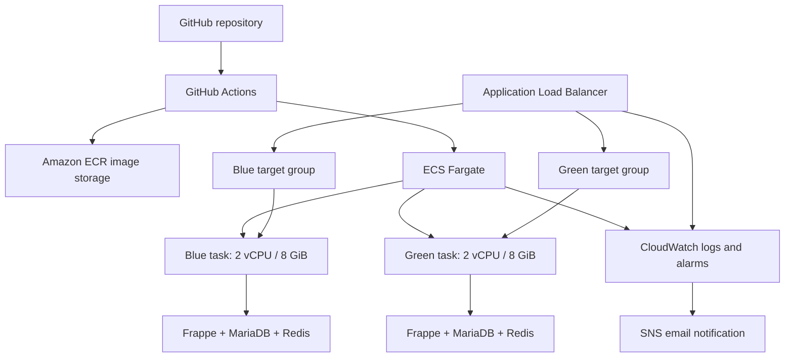
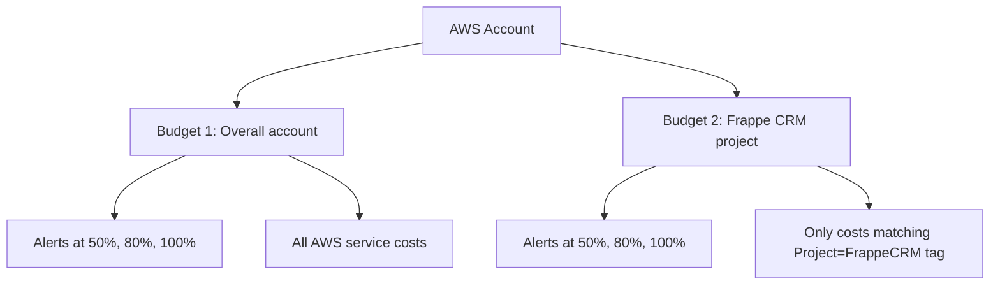

# FinOps and Cost Optimization – Frappe CRM Blue-Green on ECS Fargate

**Purpose:** Understand this project's AWS costs, estimate monthly spend, reduce waste, and configure budget email alerts.

> **Important pricing note:** These are estimates. AWS prices and Free Tier eligibility can change. Your actual bill depends on actual running time, traffic, logs, image storage, IP addresses, credits and taxes. Use Cost Explorer and the AWS Pricing Calculator to confirm your own account's charges.

---

## 1. what we actually built

In `terraform/main.tf`.

| Item | Value in our Terraform |
|---|---|
| AWS region default | `us-east-1` |
| ECS cluster | `frappe-crm-cluster` |
| ECS services | `frappe-crm-blue`, `frappe-crm-green` |
| Launch type | Fargate |
| CPU per task | `2048` CPU units = **2 vCPU** |
| Memory per task | `8192` MiB = **8 GiB** |
| Ephemeral storage per task | **40 GiB** |
| Containers in each task | Frappe, MariaDB, Redis |
| ECS desired count initially | **0 for Blue and 0 for Green** |
| Application Load Balancer | 1 internet-facing ALB, HTTP port 80 |
| Target groups | 2: Blue and Green |
| ECR repository | `frappe-crm` |
| CloudWatch log group | `/ecs/frappe-crm` |
| Log retention | 7 days |
| CloudWatch metric alarms | 3: ALB 5xx + Blue CPU + Green CPU |
| CloudWatch dashboard | 1: `frappe-crm-bluegreen` |
| SNS topic | `frappe-crm-alerts` |
| SNS email subscription | Uses Terraform variable `alert_email` |
| ECS task public IP | `assign_public_ip = true` |

**Region mismatch to fix in the project documentation:** Terraform defaults to `us-east-1`, but the current main README architecture text says `ap-southeast-2`. The Terraform default is what this estimate uses. If you deployed with `-var="region=ap-southeast-2"` or a `.tfvars` value, use that deployed region's rates instead.

**Deployment status note:** The public README currently says the first Green health-check attempt failed and the rollback kept Blue active; it also says the full automated build/deploy, successful traffic switch and rollback validation still need testing. Update that status after you have completed and verified those tests.

**Database note:** MariaDB and Redis are containers inside each Fargate task. This project does not create Amazon RDS or ElastiCache. Blue and Green each have their own MariaDB and Redis containers. This is a learning/demo setup, not a production database design.

---

## 2. How the architecture creates costs



The two task definitions exist, but **a task definition by itself does not create Fargate compute charges**. Compute charges start when a Fargate task runs.

The ALB, however, remains billable while it exists, even when both ECS services have zero running tasks.

---

## 3. Fargate cost for our exact task size

AWS Fargate charges for requested vCPU, memory and additional ephemeral storage while a task is running.

For `us-east-1`, Linux/x86, the AWS pricing example gives these rates:

| Resource | Rate used in calculation |
|---|---:|
| vCPU | $0.000011244 per vCPU-second |
| Memory | $0.000001235 per GB-second |
| Additional ephemeral storage | $0.0000000308 per GB-second |

Our task requests:

- 2 vCPU
- 8 GB memory
- 40 GB ephemeral storage
- First 20 GB ephemeral storage is included, so the billable additional storage is 20 GB.

### One task – cost per hour

| Part | Calculation | Cost/hour |
|---|---|---:|
| CPU | 2 × $0.000011244 × 3,600 | $0.08096 |
| Memory | 8 × $0.000001235 × 3,600 | $0.03557 |
| Extra storage | 20 × $0.0000000308 × 3,600 | $0.00222 |
| **Total** | | **$0.11874/hour** |

### One task – monthly cost

Assumption: 30 days × 24 hours = 720 hours.

`$0.1187424 × 720 = $85.49 per month`

| Running pattern | Fargate estimate |
|---|---:|
| 1 task, 24 hours/day for 30 days | **$85.49/month** |
| 1 task, 4 hours/day for 30 days (120 hours) | **$14.25/month** |
| 1 task, 2 hours/day for 30 days (60 hours) | **$7.12/month** |
| 2 tasks, 24 hours/day for 30 days | **$170.99/month** |

Blue-Green deployment can temporarily run both tasks while the new environment is checked. During that overlap, both tasks are billed. After a successful switch, the old service should be scaled back to zero.

**Cost-saving point:** The Terraform sets both ECS services to `desired_count = 0` initially. The deployment script starts the idle service when needed. Keeping the unused service at zero avoids paying for an idle second Fargate task.

---

## 4. Other AWS service costs in this project

### 4.1 Application Load Balancer (ALB)

Our Terraform creates one Application Load Balancer.

For `us-east-1`, the ALB base hourly price used for this estimate is `$0.0225/hour`.

`$0.0225 × 720 hours = $16.20/month`

This is only the ALB hourly base charge. LCU usage is additional and depends on connections, active connections, processed bytes and rule evaluations.

**Important:** The ALB costs money even when both ECS services are stopped. If this is only a temporary demo, delete the infrastructure when you no longer need it.

### 4.2 Public IPv4 addresses

AWS charges `$0.005` per public IPv4 address per hour.

For an example with two public IPv4 addresses on the internet-facing ALB:

`2 × $0.005 × 720 = $7.20/month`

Our ECS tasks also use `assign_public_ip = true`. Each running task can therefore add another public IPv4 address charge:

`1 task × $0.005 × 120 hours = $0.60` for a 4-hour-per-day demo pattern.

The actual number of ALB addresses and task addresses depends on the deployed networking configuration and running tasks. Check the public IPv4 usage in Cost Explorer; do not assume the ALB's two addresses are the only public IPs.

### 4.3 Amazon ECR

ECR stores our Docker image in the `frappe-crm` repository. Cost mainly depends on how many GB of images are retained and for how long.

Example only: if 5 GB is stored at an illustrative `$0.10/GB-month`, storage is `$0.50/month`. Verify the current regional rate and actual stored size.

**Optimization:** Add an ECR lifecycle policy to remove old untagged images and retain only the latest required tagged images. Do not delete an image that is still needed for deployment or rollback.

### 4.4 CloudWatch

Our Terraform creates:

- One log group: `/ecs/frappe-crm`
- 7-day log retention
- Three metric alarms
- One dashboard

Potential charges include log ingestion, log storage, alarms, dashboard usage and Logs Insights queries. The exact bill depends on log volume and the account's applicable free allowances.

**Optimization:** Keep the 7-day retention, avoid unnecessary verbose logs, and review CloudWatch usage in Billing/Cost Explorer. Do not assume every CloudWatch feature is free.

### 4.5 SNS

SNS sends the CloudWatch alarm notifications to the configured email address. Cost depends on notification/request volume and the current regional pricing. For a small number of project alerts, usage is usually small, but check the bill rather than assuming it is zero.

### 4.6 GitHub Actions

GitHub Actions runs the build and deployment workflows. GitHub-hosted runner minutes are billed by GitHub according to the account plan and included allowance, not as an AWS ECS service charge. AWS resources created by the workflow (such as ECR images and running ECS tasks) can still create AWS charges.

### 4.7 Resources with no separate hourly charge here

Terraform, IAM roles/policies, security groups, ECS cluster control plane, target groups and listener do not each have a separate hourly compute charge in this design. The resources they connect to (for example ALB and Fargate) do have charges.

The current Terraform does **not** create a NAT Gateway, RDS database or ElastiCache cluster. Do not add those services to this project's cost estimate unless you created them separately.

---

## 5. Monthly cost examples for this project

These examples use `us-east-1`, a 30-day month, one task at a time, two ALB public IPv4 addresses, and one task public IPv4 address while the task runs.

### Example A – project used for demos, 4 hours/day

| Cost item | Calculation | Estimate |
|---|---|---:|
| Fargate | 1 task × 120 hours | $14.25 |
| ALB base | 720 hours | $16.20 |
| ALB public IPv4 | 2 IPs × 720 hours | $7.20 |
| Task public IPv4 | 1 IP × 120 hours | $0.60 |
| **Subtotal** | | **$38.25/month** |

This subtotal excludes ALB LCU usage, ECR storage, CloudWatch, SNS, data transfer, taxes and other account resources.

### Example B – one task running all month

| Cost item | Calculation | Estimate |
|---|---|---:|
| Fargate | 1 task × 720 hours | $85.49 |
| ALB base | 720 hours | $16.20 |
| ALB public IPv4 | 2 IPs × 720 hours | $7.20 |
| Task public IPv4 | 1 IP × 720 hours | $3.60 |
| **Subtotal** | | **$112.49/month** |

This subtotal also excludes ALB LCU usage, ECR, CloudWatch, SNS, data transfer, taxes and any other AWS resources.

**What these examples tell us:** For a demo project, the ALB and its public IPv4 addresses are fixed costs while the ALB is left running. Scaling ECS to zero reduces Fargate cost, but it does not stop the ALB or its public IP charges.

---

## 6. FinOps optimization plan – what should we change?

Do these in a sensible order. Measure first; do not reduce resources blindly.

| No. | Optimization | Why it helps | Current status |
|---|---|---|---|
| 1 | Keep the inactive Blue/Green service at zero tasks | Avoids paying for two running environments unnecessarily | Initially configured with desired count 0 |
| 2 | Stop running tasks after demos | Reduces Fargate and task public IPv4 charges | Manual / deployment workflow |
| 3 | Delete the ALB and infrastructure when the project is not needed | Removes ongoing ALB and related charges | Manual cleanup |
| 4 | Review Fargate CPU and memory usage | May allow a smaller task size | Measure before changing |
| 5 | Add an ECR lifecycle policy | Removes old images that are no longer required | Not configured in current Terraform |
| 6 | Keep CloudWatch logs for 7 days | Prevents unlimited log retention | Already configured |
| 7 | Review CloudWatch log volume and alarms | Avoids unnecessary monitoring charges | Review monthly |
| 8 | Review public IPv4 usage | Finds charges from ALB and running tasks | Review in Cost Explorer |
| 9 | Avoid creating a NAT Gateway unless required | NAT Gateway has hourly and data-processing charges | Not created by current Terraform |

### CPU and memory optimization

Our task has 2 vCPU and 8 GB memory. Frappe, MariaDB and Redis share those resources.

Do not immediately change `cpu = 2048` or `memory = 8192`.

Correct process:

1. Run the application and perform normal tests.
2. Open CloudWatch and check ECS CPUUtilization.
3. Check memory usage using Container Insights or another suitable memory metric; standard ECS service metrics do not automatically provide every container memory metric.
4. Check whether the application starts reliably and responds normally.
5. Test a smaller valid Fargate CPU/memory combination in a safe test deployment.
6. Repeat startup, health-check and application tests.
7. Compare cost and performance.
8. Keep the smaller size only if it passes the tests.

### Infrastructure cleanup

If you do not need the project for a while:

1. Confirm that no demo or test is running.
2. Confirm that any data or logs you need are retained.
3. Run `terraform plan -destroy` and review the plan.
4. If the plan is correct, run `terraform destroy`.
5. Check the AWS Console for leftover resources.
6. Check Cost Explorer after billing data updates.

Do not delete Terraform state before infrastructure cleanup. Do not run destroy if you still need the environment.

---

## 7. AWS Budgets – account budget vs project budget

**Answer: AWS Budgets can create more than one budget in the same AWS account.** A budget can monitor the whole account or a filtered portion of the account's costs.

You do not need a separate AWS account for each project.

There are three useful scopes:

| Budget type | What it monitors | How |
|---|---|---|
| Overall account budget | All AWS costs in this account | No project/service filter |
| Project budget | Costs associated with Frappe CRM | Filter by an activated cost allocation tag such as `Project=FrappeCRM` |
| Service budget | One AWS service, such as Amazon ECS or CloudWatch | Filter by AWS Service |

A budget is a monitoring and alerting configuration. It does not create a spending cap and does not automatically stop resources unless you separately configure a supported budget action.

### Visual example – two budgets in one account



### Sample 1 – overall AWS account budget

| Setting | Example value |
|---|---|
| Budget name | `Monthly-Account-Budget` |
| Budget type | Cost budget |
| Period | Monthly |
| Scope | Entire AWS account |
| Example amount | **$150/month** |
| Actual cost alerts | 50%, 80%, 100% |
| Forecast alert | 100% |
| Notification | Your verified email address |

This monitors all services and projects in the account. If you use EC2, S3 or another project in the same account, their costs are included too.

### Sample 2 – Frappe CRM project budget

| Setting | Example value |
|---|---|
| Budget name | `Frappe-CRM-Monthly-Budget` |
| Budget type | Cost budget |
| Period | Monthly |
| Scope | Cost allocation tag `Project=FrappeCRM` |
| Example amount | **$50/month** |
| Actual cost alerts | 50%, 80%, 100% |
| Forecast alert | 100% |
| Notification | Your verified email address |

The `$50` example is intended for a demo pattern similar to Example A, with a little buffer. It is not enough for the always-on Example B subtotal of `$112.49`, even before the excluded charges.

**Important:** The current Terraform does not add a `Project` cost allocation tag to its resources. To make the project budget work, add consistent tags to supported resources, for example:

```hcl
tags = {
  Project     = "FrappeCRM"
  Environment = "Learning"
  ManagedBy   = "Terraform"
}
```

Add the tags to the taggable resources created by Terraform (for example ECR, ALB, target groups, ECS cluster/services, CloudWatch log group and SNS topic). Then activate the `Project` user-defined cost allocation tag in Billing → Cost Allocation Tags. Wait for the tag to become active and for tagged cost data to appear. Some shared or untaggable charges may not be captured by the project tag, so compare with the account budget and Cost Explorer.

You can also create a service budget without project tags by selecting the AWS Service filter, for example Amazon Elastic Container Service. That budget monitors the selected service's costs across the account, not just this one project.

---

## 8. monthly AWS Budget and email alerts

For a `$150` account budget, the example actual alerts are `$75`, `$120` and `$150`. For a `$50` project budget, they are `$25`, `$40` and `$50`.

**Alert timing:** AWS Budgets notifications are not real-time. Cost data and forecast calculations can be delayed. Keep checking Cost Explorer and the Billing dashboard.

**Budgets do not stop ECS tasks automatically.** They send notifications unless you deliberately configure an appropriate budget action. For this learning project, email alerts plus manual review are a safer starting point.

### Does AWS Budgets itself cost money?

AWS currently states that budgets without actions are free. The first two action-enabled budgets are free; additional action-enabled budgets can incur a daily charge. Check the official pricing page before enabling actions.

---

## 9. Where to check the actual bill

Use these pages:

| AWS page | What to check |
|---|---|
| Billing → Bills | Final charges for the billing period |
| Cost Explorer | Cost grouped by Service, Region, Usage Type or Tag |
| Billing → Budgets | Budget thresholds and alert status |
| Billing → Cost allocation tags | Activate the `Project` tag |
| ECS → Cluster → Services | Desired count and running tasks |
| CloudWatch → Metrics | CPU and ALB metrics |
| CloudWatch → Log groups | Log volume and retention |
| ECR → Repositories | Image count and stored size |
| VPC → Public IP Insights / Cost Explorer | Public IPv4 usage |

A good weekly FinOps habit is to open Cost Explorer, group costs by **Service**, then check the biggest cost first.

---

## 10. Final action checklist

- [ ] Confirm the actual deployment region in Terraform state / AWS Console.
- [ ] Check the actual bill in Cost Explorer.
- [ ] Create the overall account budget.
- [ ] Add `Project=FrappeCRM` tags to supported Terraform resources.
- [ ] Activate the `Project` cost allocation tag.
- [ ] Create the Frappe CRM project budget.
- [ ] Confirm the budget email address.
- [ ] Keep the inactive ECS service at zero tasks.
- [ ] Stop tasks after demos.
- [ ] Review ALB and public IPv4 charges.
- [ ] Measure CPU and memory before resizing.
- [ ] Add an ECR lifecycle policy.
- [ ] Clean up unused infrastructure safely.

## 11. Official pricing and documentation

- [AWS Fargate pricing](https://aws.amazon.com/fargate/pricing/)
- [AWS Application Load Balancer pricing](https://aws.amazon.com/elasticloadbalancing/pricing/)
- [AWS public IPv4 pricing](https://aws.amazon.com/vpc/pricing/)
- [Amazon ECR pricing](https://aws.amazon.com/ecr/pricing/)
- [Amazon CloudWatch pricing](https://aws.amazon.com/cloudwatch/pricing/)
- [Amazon SNS pricing](https://aws.amazon.com/sns/pricing/)
- [AWS Budgets pricing](https://aws.amazon.com/aws-cost-management/aws-budgets/pricing/)
- [Create a cost budget – AWS documentation](https://docs.aws.amazon.com/cost-management/latest/userguide/create-cost-budget.html)
- [AWS Budget filters](https://docs.aws.amazon.com/cost-management/latest/userguide/budgets-create-filters.html)
- [AWS Pricing Calculator](https://calculator.aws/)

---

**Conclusion:** For this project, the biggest controllable cost is Fargate running time. The ALB and public IPv4 addresses can continue costing money even when ECS is scaled to zero. Use an account-wide budget to protect the whole account, and a separately filtered project budget to track Frappe CRM. Verify all savings against Cost Explorer rather than relying only on estimates.
