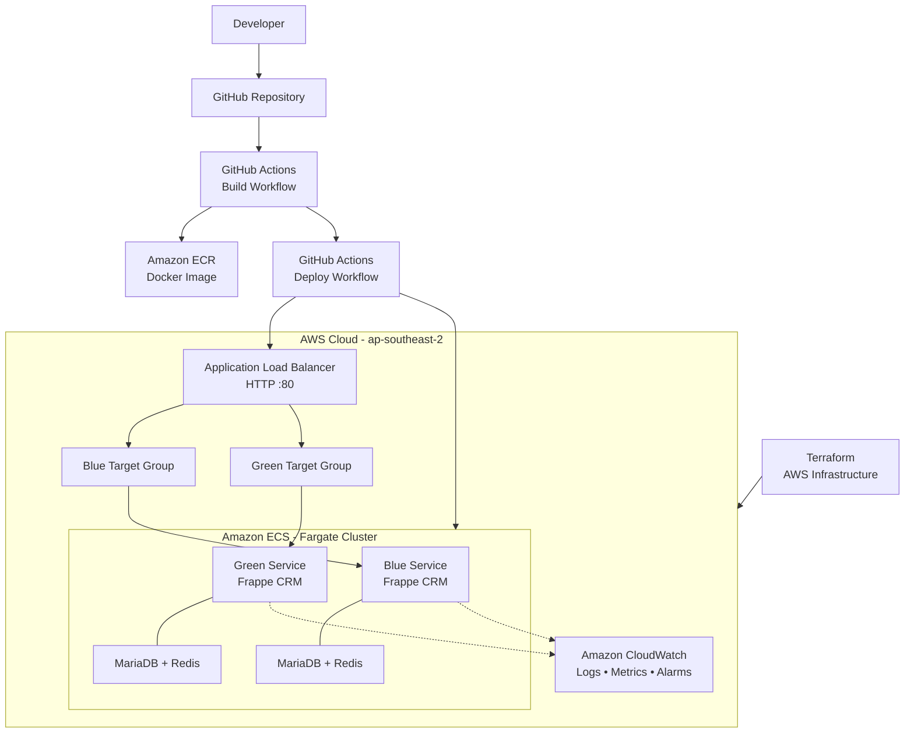
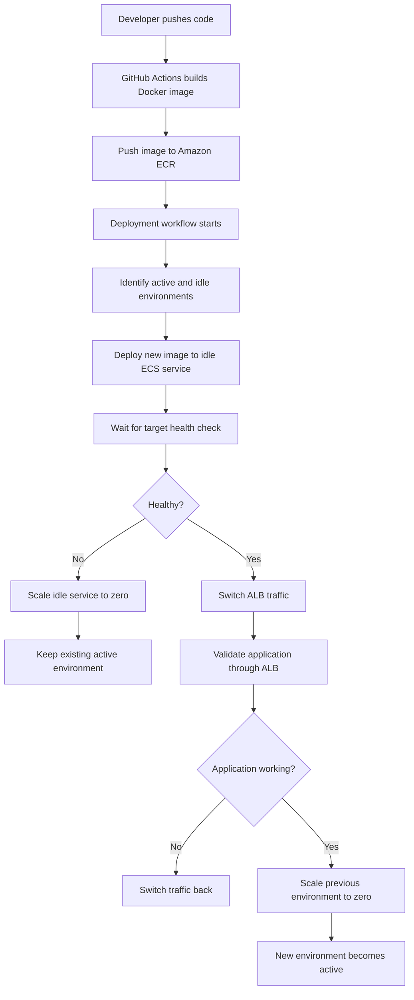

# Frappe CRM – AWS ECS Blue-Green Deployment

## 1. Project Overview

This project demonstrates how to deploy **Frappe CRM on AWS ECS Fargate using a Blue-Green deployment strategy**.

The infrastructure is provisioned using Terraform, application images are stored in Amazon ECR, GitHub Actions automates the build and deployment process, and Amazon CloudWatch provides monitoring and logging.

The main objective is to deploy a new application version without immediately affecting the currently running version.

## 2. Architecture



### Architecture components

| Component | Responsibility |
|---|---|
| GitHub | Source code and workflow management |
| GitHub Actions | Docker build, ECR push and deployment automation |
| Docker | Packages the Frappe CRM application |
| Amazon ECR | Stores application container images |
| Amazon ECS Fargate | Runs Blue and Green application services |
| MariaDB | Application database |
| Redis | Cache and queue services |
| Application Load Balancer | Routes HTTP traffic to the active environment |
| Terraform | Provisions and manages AWS infrastructure |
| CloudWatch | Collects logs, metrics and alarms |

**Note:** Blue and Green currently use separate MariaDB and Redis sidecars. This is a practice architecture, not a production database design. Each environment has its own database data.

## 3. Blue-Green Deployment Workflow



### Deployment sequence

1. A developer pushes changes to the GitHub repository.
2. GitHub Actions builds the Docker image.
3. The image is pushed to Amazon ECR.
4. The deployment workflow runs after a successful build.
5. The deployment script identifies the active and idle environments.
6. The new image is deployed to the idle ECS service.
7. The idle environment must pass the ALB target health check.
8. If healthy, ALB traffic switches to the new environment.
9. The application is checked through the ALB endpoint.
10. If validation succeeds, the previous environment is scaled down.
11. If validation fails, traffic is switched back to the previous environment.

## 4. Technology Stack

- **Cloud:** AWS
- **Containerization:** Docker
- **Container Registry:** Amazon ECR
- **Container Orchestration:** Amazon ECS Fargate
- **Infrastructure as Code:** Terraform
- **CI/CD:** GitHub Actions
- **Load Balancing:** Application Load Balancer
- **Monitoring:** Amazon CloudWatch
- **Application:** Frappe CRM
- **Database:** MariaDB
- **Caching and Queuing:** Redis
- **Scripting:** Bash

## 5. Repository Structure

```text
frappe-crm-bluegreen-ecs/
│
├── .github/
│   └── workflows/
│       ├── build.yml
│       └── deploy.yml
│
├── scripts/
│   └── deploy.sh
│
├── terraform/
│   └── main.tf
│
├── Dockerfile
├── start.sh
├── README.md
└── .gitignore
```

## 6. AWS Infrastructure

Terraform manages the following infrastructure:

- Amazon ECR repository
- ECS cluster
- Blue and Green ECS services
- ECS task definitions
- Application Load Balancer
- Blue and Green target groups
- ALB listener
- IAM roles and policies
- Security groups
- CloudWatch log group
- CloudWatch dashboard and alarms
- SNS notification resources

## 7. Monitoring and Validation

Amazon CloudWatch is used to monitor:

- ECS application container logs
- ECS service CPU utilization
- Application load balancer HTTP 5xx errors
- Deployment health and application behavior

Deployment validation includes:

- Docker image build and push
- ECS task startup
- ALB target health checks
- Application endpoint validation
- Blue-Green traffic switching
- Rollback behavior

## 8. Deployment Configuration

The project uses the AWS region:

```text
ap-southeast-2
```

The application is exposed through the Application Load Balancer over HTTP port 80.

The application health endpoint used by the deployment process is:

```text
/api/method/ping
```

GitHub repository secrets required:

```text
AWS_ACCESS_KEY_ID
AWS_SECRET_ACCESS_KEY
```

Never store actual AWS credentials in source code or commit them to GitHub.

## 9. Project Validation Status

The AWS infrastructure has been provisioned and the deployment script has been executed.

The first Green deployment attempt did not pass the target health check. The rollback logic kept Blue active.

The complete automated GitHub Actions build and deployment pipeline, successful traffic switching, and rollback validation remain to be tested.

## 10. Cost and Cleanup

This project uses AWS resources that can incur charges, including the Application Load Balancer and running ECS Fargate tasks.

After completing the demonstration, review the deployed resources and destroy the infrastructure using Terraform when it is safe to do so.

**Important:** Never delete Terraform state before the infrastructure cleanup is complete.